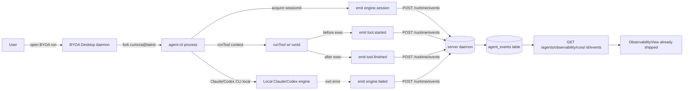

# Design: agent-events-capture

## 1. Overview

This spec moves the **event emission responsibility** from `server/src/agents/computer/daemon.ts` (where the new wiring landed during agent-run-detail v0 but never reached the running artifact) into `agent-cli/` — the package that's actually invoked when a user runs a BYOA Claude or BYOA Codex agent. The server daemon keeps its current `POST /runtime/events` consumer; the CLI gains the producer.

After this lands:
- BYOA CLI emits `engine.session` / `engine.failed` / `tool.started` / `tool.finished` via the existing `/runtime/events` endpoint.
- `agent_events` table gets populated for every BYOA Claude/Codex run.
- Devtools / ObservabilityView (already shipped in agent-run-detail v0) finally has real data to render.

## 2. Architecture



- **Producer** (new in this spec): `agent-cli/src/events/emitter.ts` — wraps `POST /runtime/events` with auth, retry, tenant header, payload validation.
- **Consumer** (existing): `server/src/agents/computer/daemon.ts` `recordEngineSession` etc. — no change, this spec does not touch server daemon.
- **Schema** (existing): `agent_events` table, no DB migration.
- **API** (existing): `POST /runtime/events` accepts `{ runId, kind, level, title, data, stage }`. We use that.
- **CLI surface** (modified): `runCli` + `runTool → executeTool` boundary gains runId + emitter calls.

## 3. Module layout (new in agent-cli/)

```
agent-cli/src/
  events/
    emitter.ts          # POST /runtime/events wrapper (auth + retry + tenant)
    contract.ts         # EngineSession, ToolStarted, ToolFinished, EngineFailed shapes
    runtime-context.ts  # Pass runId through runTool boundary
  tests/
    emitter.test.ts     # Unit tests on contract shape + retry
    e2e-smoke.test.ts   # End-to-end: spin local daemon, run CLI, assert agent_events row
```

No DB schema change. No new HTTP endpoints. The CLI is the only new producer-side code; everything else is reuse.

## 4. Key design decisions

1. **CLI is the producer, server is the consumer.** The dev branch already wrote the consumer side; we just need to flip responsibility. CLI must own `recordEngineSession` and emit. Server daemon's existing `recordEngineSession` becomes a write-to-DB helper that the CLI's POST triggers.

2. **runId flows through `runTool` boundary.** Today (per Iris's diagnosis) `runTool → executeTool` doesn't carry runId. Fix: pass runId via `runtime-context.ts`, a small wrapper that uses AsyncLocalStorage or explicit context parameter. We pick **explicit parameter** for testability.

3. **No 500-cap, no `events.truncated`.** Same decision as agent-run-detail v0: trust backend's existing limit. If volume becomes an issue, separate spec.

4. **Best-effort writes.** Emitter retries once on 5xx, then logs and drops. Agent turn NEVER blocks on event emission failure (N2).

5. **Empty session id rejected at the emitter.** If CLI's local engine returns `sessionId === ''` or whitespace-only, emitter drops the `engine.session` event silently — no synthetic events.

6. **`engine.failed` always on error.** Different from `engine.session` (only on success): failure path must write an event so the run is observable, even when no session exists.

7. **v0 is local-only, not published.** Skyblue decision 2026-08-21. The shipping story (CLI 0.1.128 → `npm exec cumora@latest`) is a separate later spec. Don't conflate "wiring works locally" with "users get new CLI artifact".

## 5. Contract shapes

```ts
type AgentEvent = {
  runId: string
  kind: 'engine.session' | 'engine.failed' | 'tool.started' | 'tool.finished'
  level: 'info' | 'warn' | 'error'
  stage: 'engine_session' | 'engine_failed' | 'tool_started' | 'tool_finished'
  title: string
  data: Record<string, unknown>
}

type EngineSessionData = {
  engine: 'claude' | 'codex'
  sessionId: string  // trim-non-empty
}

type EngineFailedData = {
  engine: 'claude' | 'codex'
  reason: string
  retryCount?: number
}

type ToolStartedData = {
  tool: string
  args: Record<string, unknown>  // allowlisted
}

type ToolFinishedData = {
  tool: string
  ok: boolean
  result?: unknown  // allowlisted
  error?: string
}
```

`allowlist` projection for tool args/result is shared with agent-run-detail v0 (`src/lib/agentRunDetail.ts` `projectObservableEvent`). Both specs consume the same allowlist.

## 6. Failure modes

| Failure | Emitter behavior | Agent behavior |
|---|---|---|
| Server returns 5xx | Retry once with 500ms backoff, then drop + log | Run continues normally |
| Server returns 4xx (auth / tenant) | Drop + log + emit warning to stderr | Run continues |
| Network unreachable | Drop + log + emit stderr | Run continues |
| Auth header missing | Drop + log + emit stderr | Run continues; dev-session will retry on next event |
| Local engine returns empty sessionId | Drop silently | Run continues; session area will show Unavailable (correct behavior per agent-run-detail v0) |
| Tool args contain raw chain-of-thought | Drop silently + emit stderr warning | Run continues; allowlist filter protects display layer |

## 7. Test strategy

- **Unit tests on emitter** — every contract shape, retry behavior, drop conditions.
- **Unit tests on runtime-context** — runId flows correctly, no leakage between concurrent runs.
- **Unit tests on allowlist projection** — tool args / results filter reasoning fields.
- **E2E smoke** — start local daemon + dev server, fire a `pwd` BYOA Claude run via local CLI build, assert `agent_events` table has the 4 expected rows for that `run_id`.
- **CI integration** — new `npm run test:agent-events-capture` script parallel to `test:agent-run-detail`.

## 8. Risks & mitigations

- **Auth drift between CLI and server.** The emitter's auth header source MUST be the same source the local dev-session uses; if not, server tenant gate rejects. Mitigation: extract auth header into a shared helper used by both CLI's `cumora inbox` and the new emitter.
- **Race between runId assignment and tool execution.** If runId is set lazily, a tool fired before runId exists has no event. Mitigation: emitter throws if runId is undefined — fail-fast forces caller to wait for runId.
- **Concurrent runs.** Two CLIs emitting events for two different runs must not cross-correlate. Mitigation: each CLI instance has a single runId; server daemon's existing runId filter handles the rest.

## 9. Out of scope (this spec) — same as requirements

No display changes, no new event kinds, no managed/cloud, no pagination.