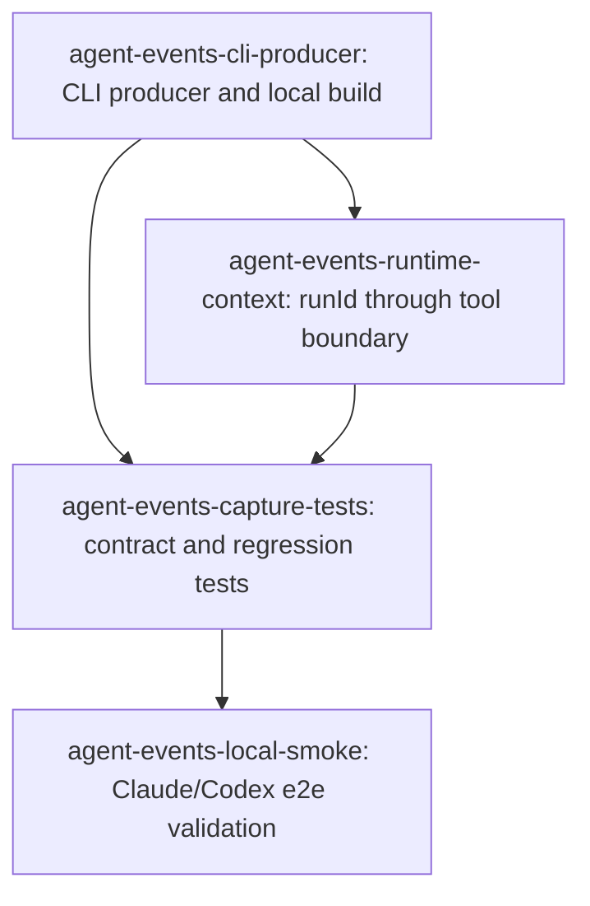

# Tasks: agent-events-capture

> 本文件是 `.orca/feat-builder/agent-events-capture/task-list.json` 的可读归档；任务 ID、依赖和验收标准必须保持一致。

## Task List

### agent-events-cli-producer: 在本地 BYOA CLI 产物中发出 engine 事件

**Scope**:

- `agent-cli/src/`
- `server/src/agents/computer/daemon.ts`
- `server/src/agents/computer/session-observability.ts`
- `agent-cli/package.json`

**Owner**: Bram

**Depends on**: none

**Acceptance Criteria**:

1. 从源码构建的本地 CLI 能在 Claude/Codex 获得非空 session id 后，向现有 `/runtime/events` 发送一次 `engine.session`；engine 仅允许 `claude` 或 `codex`，session id 必须 trim 后非空。
2. engine 启动失败或退出失败时，在结束 agent run 前 best-effort 发送 `engine.failed`，错误信息不阻断主 turn。
3. 事件 payload 遵循现有 consumer contract：包含 `runId`、`kind`、`level`、`title`、`data` 和 `stage`，沿用现有 Authorization header 和租户边界。
4. `agent-cli` 可通过本地 build 入口运行，不依赖 `npm exec cumora@latest`；本任务不发布 npm artifact。
5. 空 session id、未知 engine 和事件网络失败均不会伪造事件或把 engine turn 误判为失败。

**Risk**: medium

### agent-events-runtime-context: 将 runId 传过 CLI tool boundary

**Scope**:

- `server/src/agents/runtime/server.ts`
- `server/src/agents/runtime/cli-argv.ts`
- `server/src/agents/cli.ts`
- `server/src/agents/tools.ts`

**Owner**: Bram

**Depends on**: agent-events-cli-producer

**Acceptance Criteria**:

1. `/runtime/cli` 从已认证 BYOA 请求取得当前 runId，并将其显式传入 `runCli`、`runTool` 和 `executeTool`；缺失或空 runId 不写未关联的事件。
2. 每次 tool execution 在执行前后 best-effort 记录 `tool.started` 和 `tool.finished`，成功、业务失败和异常路径都能得到结束事件。
3. `tool.started` / `tool.finished` 仅携带 allowlist 允许的参数、结果和错误摘要，不写入 reasoning 或 chain-of-thought。
4. runId 只能和当前已认证 agent/tenant 关联，不能通过 CLI argv 中的 `--as` 改变身份或跨租户写入。

**Risk**: high

### agent-events-capture-tests: 补齐 contract、边界和回归测试

**Scope**:

- `agent-cli/src/events/*.test.ts`
- `server/src/__tests__/agent-engine-session-event.test.ts`
- `server/src/__tests__/agent-computer-shim-output.test.ts`
- `server/src/__tests__/agents-runtime-cli-argv.test.ts`
- `package.json`

**Owner**: Bram

**Depends on**: agent-events-cli-producer, agent-events-runtime-context

**Acceptance Criteria**:

1. 单测覆盖 engine.session 的 Claude/Codex 合法 payload、空 id、未知 engine、重复事件和 reset 后旧 session 不残留。
2. 单测覆盖 engine.failed 的错误路径、事件发送失败的 best-effort 语义，以及 tool.started/tool.finished 的成功和失败路径。
3. 单测验证 runId 在 shim 请求和 runTool → executeTool 边界中保持不串 run；租户与 `--as` 身份防护不回归。
4. 新增独立 `npm run test:agent-events-capture` 入口，并保留 `npm run test:agent-run-detail` 回归入口。
5. 测试不要求真实 npm 发布；所有本地依赖和构建命令在 dev repo 中可复现。

**Risk**: medium

### agent-events-local-smoke: 用源码产物完成 Claude/Codex e2e smoke

**Scope**:

- `agent-cli/dist/cli.js`（构建产物，不直接编辑）
- dev server / `agent_events` 数据
- `docs/specs/agent-events-capture/` 验证记录

**Owner**: Bram + Iris

**Depends on**: agent-events-capture-tests

**Acceptance Criteria**:

1. 使用本地 daemon build/run 触发一个有实际输入的 Claude run，并在同一 run_id 查到非空 `engine.session`、至少一条 `tool.started` 和一条 `tool.finished`。
2. 使用本地 daemon build/run 触发一个有实际输入的 Codex run，并得到同样的事件形状。
3. 复现 Codex reconnect-exhaustion 时，`engine.failed` 在 run close 前写入；事件写入失败不会阻断 engine 结束。
4. 在 Devtools 中打开同一最新 run，session id 与 tool timeline 可见；空输入 run 不计入 smoke 证据。
5. 记录构建命令、run id、事件查询结果和已知环境阻断；npm publish 不属于本任务。

**Risk**: high

## DAG

## Statistics

- **Total tasks**: 4
- **Max parallelism**: 2
- **Critical path length**: 4
- **Publish tasks**: 0
