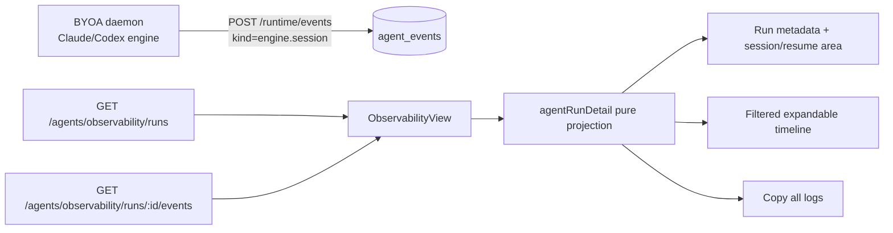

# Design: agent-run-detail

## 1. Overview

本特性在现有 `src/desktop/ObservabilityView.tsx` 的 run 列表和时间线基础上，补齐单次 Run 的安全详情体验。后端继续复用 `agent_runs` 和 `agent_events` 以及现有租户校验；BYOA daemon 在获得 Claude/Codex session id 后追加一个最小的 `engine.session` 事件，前端从同一批事件派生事件数量、engine/session 信息、筛选结果、可复制日志和 resume 命令。

详情始终是只读观察面板：它不修改 run、不控制 Agent，也不承担 Workflow DAG。所有事件详情和复制内容先经过同一份安全投影，Think 只保留可观测状态或摘要，不把原始思维链当作日志输出。

## 2. Architecture

现有数据流保持不变，新增 session 观测和前端纯函数层：



- `server/src/agents/computer/daemon.ts` 在聊天唤醒和 agenda 唤醒的同一 run 生命周期中读取当前 `sessionId`，只在 id 非空且仍然有效时记录 `engine.session`。现有 runtime `/events` 已经支持任意 kind/data，因此不需要新增 HTTP endpoint。
- `agent_events.data` 使用 `{ engine, sessionId }` 的小对象；前端从该 run 的 session 事件取最后一个有效值，兼容旧 daemon 没有此事件的情况。session 事件按 run 记录最终仍有效的 id，重置发生在记录前时不写入旧 id，因此不需要在同一 run 中增加“撤销旧 session”的伪事件。
- `src/lib/agentRunDetail.ts` 提供分类、确定性排序、安全投影、复制文本和 resume 命令生成。`ObservabilityView` 只负责状态、交互和布局，不在 JSX 中重复安全规则。
- 详情筛选在已加载的单 Run 事件集合上完成，不新增 server-side 查询参数；复制动作明确使用完整事件集合，避免把当前筛选误当成完整日志。

## 3. Data Model

无数据库表结构变更。继续使用：

- `agent_runs`：已有 `status`、`stage`、`summary`、`trigger`、`started_at`、`finished_at`、`durationMs` 等字段，满足详情头部的运行元数据。
- `agent_events`：已有 `kind`、`level`、`title`、`data`、`created_at` 和 `(run_id, created_at ASC)` 索引。新增一个逻辑事件约定：

  ```json
  {
    "kind": "engine.session",
    "level": "info",
    "title": "Claude engine session available",
    "stage": "engine_session",
    "data": { "engine": "claude|codex", "sessionId": "<non-empty id>" }
  }
  ```

- session 事件不保存 prompt、token 或思维内容；同一 run 只报告当前有效 session，session 重置后不追加失效 id。旧 run 没有该事件时 UI 显示 unavailable。
- session 事件只支持 `claude` 和 `codex`；managed/Cumora Cloud、旧 daemon 或其他 engine 不写入该事件。一个 run 最多写入一个最终有效的 session 事件，避免把跨 wake 的历史 id 误当成当前可 resume 目标。`sessionId` trim 后必须非空，标题不得包含 id。
- 既有 `agent_events` 的数据库 GC/保留策略和租户过滤继续生效；前端复制文本只使用 API 返回的事件，不读取 daemon 本地 session 文件。
- v0 不新增事件数量上限、分页或 `events.truncated` 协议；详情接口返回当前 run 的完整事件集合，未来限流必须另开后端设计。

## 4. Interfaces

现有 HTTP 接口保持路径和权限不变：

- `GET /agents/observability/runs` 返回现有 `ApiAgentRun`，详情事件数量由选中 run 的事件集合计算。
- `GET /agents/observability/runs/:id/events` 先执行现有 Devtools 权限和 tenant 归属校验，再返回该 run 的完整 `ApiAgentEvent[]`；数据库按 `created_at ASC, id ASC` 排序，wire format 使用现有 camelCase 字段（包括 `runId`、`agentId`、`createdAt`）。不存在或不属于当前 tenant 的 run 均返回 not found，v0 不增加分页或 server-side 筛选。
- BYOA daemon 复用现有 `POST /runtime/events`，发送 `runId`、`kind`、`level`、`title`、`data`、`stage`，不新增 runtime API。

前端纯函数接口建议保持窄小且无副作用：

- `classifyAgentRunEvent(event): 'agent' | 'tool-call' | 'tool-result'`
- `sortAgentRunEvents(events): ApiAgentEvent[]`
- `projectObservableEvent(event): SafeAgentEvent`
- `getAgentRunSession(events): AgentRunSession | null`
- `formatAgentRunLogs(run, events): string`
- `buildResumeCommand(engine, sessionId): string | null`

下游 `docs/specs/cumora-self-evolve/` 的 `observe.ts` 只能把 `agent_runs`/`agent_events` 当作只读观测源，不能依赖前端投影或读取 daemon 本地 session 文件；事件 kind 或 session contract 变更时，两个 spec 必须一起更新。

Claude 命令使用 `claude --resume <shell-quoted-id>`，Codex 命令使用 `codex resume <shell-quoted-id>`；UI 只复制命令。Grok/managed 或空 session 不生成命令。

## 5. Design Decisions

1. **使用事件而不是新增 agent_runs 列**：session id 只由本地 BYOA engine 产生，且现有 event API 已经是 Run 详情的时间线来源；增加列会让 cloud、旧 daemon 和跨运行 session 生命周期产生空值/同步问题。最小 `engine.session` 事件足以关联当前 run，同时无需数据库迁移。
2. **安全投影集中在纯函数**：详情展示和 Copy all logs 必须遵守同一条 Think 边界。集中投影可避免新增一种复制路径意外绕过 JSX 中的隐藏规则，也便于用 Node 单元测试覆盖。
3. **客户端筛选而非 API 筛选**：单个 run 的事件已经一次返回，筛选只影响展示，不改变复制全部日志的语义；这样保留当前自动刷新与 API 契约的简单性。
4. **按 engine 生成命令**：Claude/Codex 的 resume 语法不同，命令由 engine 显式决定而非字符串猜测。没有可靠 engine/session 时显示不可用，避免让用户复制一个看似有效但无法 attach 的命令。
5. **默认收起详情**：事件量和 prompt/tool payload 可能很大，时间线先展示标题、kind、level、时间和摘要，用户主动展开才读取安全 payload；这也降低误看内部内容的概率。

6. **明确的状态优先级**：详情内容按“请求失败 > 加载中 > 无事件 > 有事件”处理；错误状态不复用旧事件，筛选为空只在有事件集合后展示。run 列表刷新只通过稳定的 run id 维护选中项，避免自动刷新把用户带到另一条 run。

## 6. Error Handling

- session 事件写入沿用 BYOA observability 的 best-effort 语义；写入失败不影响 Agent turn。UI 对缺失事件显示“未提供 session id”，不把写入失败当作 run 失败。
- events 请求失败时保持现有 run 头部，时间线显示错误状态并允许已有刷新入口重试；事件为空时区分“暂无事件”和请求失败。
- `navigator.clipboard.writeText` 不可用、权限被拒绝或抛错时，按钮显示失败反馈，不清空当前内容、不执行 fallback 命令。
- `engine.session` 的 `sessionId` 必须是非空字符串；空值、未知 engine 或重置后的旧 id 在前端都视为不可用。
- 安全投影对非对象数据、循环/不可序列化值和未知事件 kind 使用稳定占位或字符串化处理；未知事件仍归入 Agent 类别，不从时间线静默丢失。事件标题、summary 和 error 仅作为纯文本，禁止 HTML/Markdown 解释；超长值沿用现有截断策略。

## 7. Interaction and accessibility contract

- run 列表项、筛选项、详情展开控件和复制按钮都必须使用原生可聚焦控件，并可通过键盘完成选择、筛选、展开和复制。
- 筛选控件用 `aria-pressed` 或等价语义表达当前筛选；“Showing N of M events”、复制成功/失败和错误状态必须以可读文本呈现，不能只依赖颜色或动画。
- 事件默认收起；展开后 payload 使用等宽、可滚动文本块，长参数/结果不能撑破详情面板宽度。session id 和命令允许横向滚动，但不得截断复制值。

## 8. Test Strategy

- 后端 Node 单元测试覆盖 session 事件构造：Claude/Codex、无 id、重复 id、session 重置和两个 BYOA run 路径调用约定。
- 前端纯函数测试覆盖事件分类与排序、敏感字段过滤、reasoning summary 的允许形态、工具参数/结果保留、复制文本不受筛选影响和 Claude/Codex/不可用命令生成。为保持现有依赖，使用已安装的 `tsx` + `node:test` 增加独立 `npm run test:agent-run-detail` 入口，不引入新的测试框架。
- 纯函数测试还应覆盖 session reset 后不产生旧 id、单 run 最终 session 选择、未知事件不透传 payload，以及标题/summary/error 作为纯文本处理。
- 实现后执行 `npm run lint`、`npm run typecheck`、`npm run server:typecheck`、聚焦测试以及 `npm run build`；若运行全量 `npm test`，将现有环境缺失（如 `OPENAI_API_KEY`、`@types/node`、`mdast`、worker 的 `postal-mime`）与本特性失败分开记录。
- 手工 smoke 检查覆盖 All/Agent/Tool Call/Tool Result 筛选、详情展开、Copy all logs、Claude/Codex 命令复制、旧 run 无 session、session reset、空事件、请求失败、自动刷新选中项稳定性和键盘操作。

## 9. Risks & Mitigations

- **敏感内容泄漏**：现有 trace 可能携带 reasoning output summary 或未知供应商字段。所有详情和复制内容必须经过同一安全投影，明确过滤 raw chain-of-thought 字段；后端 session 事件只写 id，不写 prompt。
- **事件元数据泄漏**：title、summary 或 error 也可能意外携带 prompt。事件生产方只写短的可观测描述，前端按纯文本展示并对 payload 使用字段白名单；测试必须覆盖这些字段不会绕过安全投影。
- **事件洪峰**：单个 run 可能因工具循环产生大量事件。v0 沿用现有 API 和数据库保留策略，不新增截断协议；如果后续需要分页或限流，应单独设计服务端响应契约并同步更新 Copy all logs 语义。
- **BYOA 旧版本没有 session 事件**：前端把事件缺失视为正常 unavailable，其他 run 元数据和时间线仍可用。
- **session 在运行中失效**：daemon 只上报当前有效 id；reset 后不展示旧 id，避免用户 attach 到错误上下文。
- **大 payload 和频繁刷新**：前端详情按需展开，安全投影对 payload 设置边界，筛选/复制只在选中 run 上计算；不新增全局日志轮询。若未来需要分页或截断，必须另行设计 API 契约。
- **剪切板权限差异**：按钮使用显式成功/失败状态，失败不阻塞详情查看；命令仍可在代码块中选中复制。
- **回归到已有 Devtools 面板**：保留 `traces/workspace/triage` 面板路由、现有自动刷新和租户 API，改动集中在 traces 的选中详情区域。
