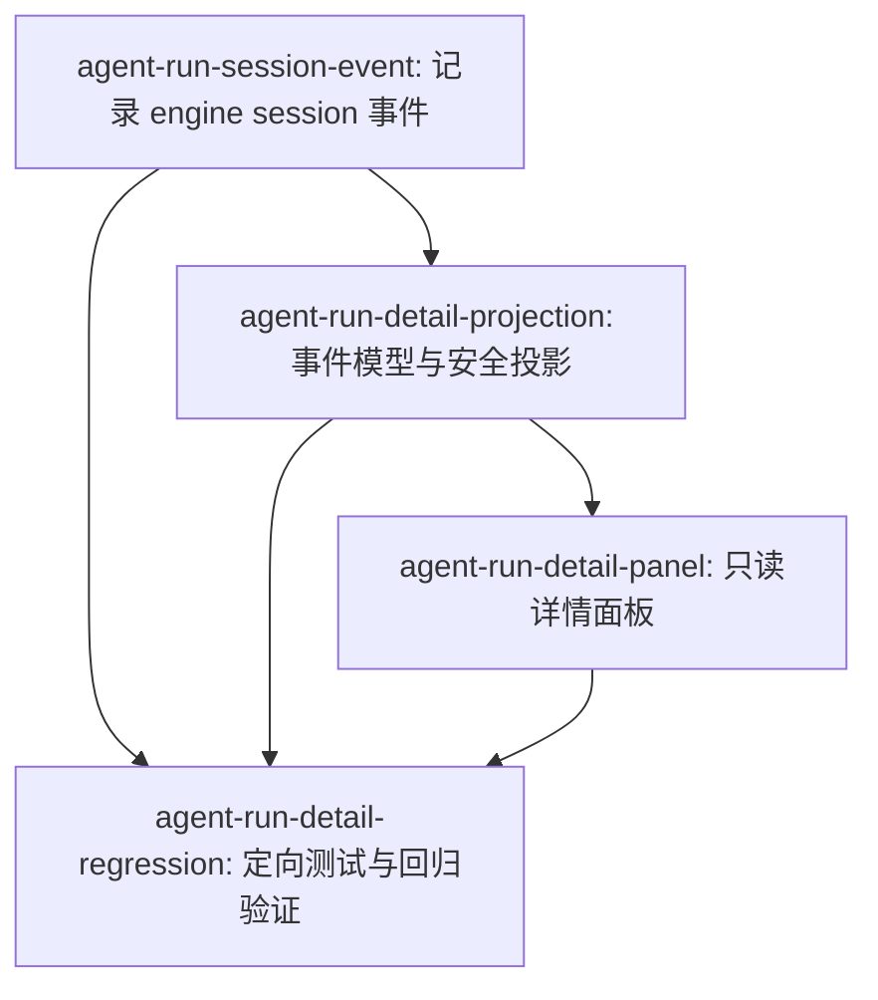

# Tasks: agent-run-detail

> 本文件是 `.orca/feat-builder/agent-run-detail/task-list.json` 的可读归档；任务 ID、依赖和验收标准必须保持一致。

## Task List

### agent-run-session-event: 记录 BYOA Agent Run 的 engine session 观测事件

**Scope**:

- `server/src/agents/computer/daemon.ts`
- `server/src/agents/computer/session-observability.ts`
- `server/src/__tests__/agent-engine-session-event.test.ts`

**Depends on**: none

**Acceptance Criteria**:

1. BYOA 的聊天唤醒和 agenda 唤醒在获得非空 engine session id 后，均向当前 run 追加一次 kind=engine.session 的 agent event，data 至少包含 engine 和 sessionId；没有 session id 时不伪造事件。
2. 当 resume 目标失效并被重置时，run 详情不会展示已失效的旧 session id；事件仍沿用现有租户校验、created_at ASC/id ASC 排序和 best-effort 写入语义。
3. 新增的 session 事件构造与缺失/重复/失效场景有可执行的 Node 单元测试覆盖。

**Risk**: medium

### agent-run-detail-projection: 建立 Run 详情的事件分类、安全投影和复制命令模型

**Scope**:

- `src/lib/agentRunDetail.ts`
- `src/api/client.ts`

**Depends on**: agent-run-session-event

**Acceptance Criteria**:

1. 为 engine.session、tool.started、tool.finished 及未知事件建立稳定分类，并保留同一 run 内按 createdAt、id 的确定性时间顺序。
2. 事件详情和复制日志使用同一个安全投影：保留状态、标题、工具参数/结果和允许的摘要，过滤 reasoning、chain-of-thought、thought 等原始思维链字段，不因过滤而丢失工具调用/结果事件。
3. 根据 engine 和 sessionId 生成可复制的 Claude `claude --resume <id>` 或 Codex `codex resume <id>` 命令；缺少 id 或不支持的 engine 返回不可用状态，命令参数须进行 shell 安全引用。

**Risk**: medium

### agent-run-detail-panel: 完成单次 Agent Run 的只读详情面板

**Scope**:

- `src/desktop/ObservabilityView.tsx`

**Depends on**: agent-run-detail-projection

**Acceptance Criteria**:

1. 选中单次 run 后，详情头部展示状态、Agent 名称/角色、run id、Task/stage 或摘要、trigger、创建时间、结束时间（如有）、耗时和事件数量。
2. 事件时间线按时间升序展示 Agent、Tool Call、Tool Result；支持 All/Agent/Tool Call/Tool Result 筛选，并在没有匹配事件时显示明确空状态。
3. 每条事件都有可访问的展开/收起控件；展开内容使用安全投影展示详情，Think 只显示可观测状态或摘要，不显示原始思维链。
4. 详情提供 Copy all logs，复制内容覆盖当前 run 的全部事件而非当前筛选结果，并显示成功/失败反馈；Claude/Codex session 区域分别提供可复制 resume 命令且不执行任何命令。
5. 面板保持只读，不增加 stop/retry/编辑 agent 或 Workflow DAG 操作；加载中、请求失败、无事件、旧 daemon 未提供 session id 等状态均有稳定展示。

**Risk**: medium

### agent-run-detail-regression: 补齐详情模型测试并执行定向回归验证

**Scope**:

- `src/lib/agentRunDetail.test.ts`
- `server/src/__tests__/agent-engine-session-event.test.ts`
- `package.json`

**Depends on**: agent-run-session-event, agent-run-detail-projection, agent-run-detail-panel

**Acceptance Criteria**:

1. 测试覆盖事件分类/排序、筛选不影响全量日志复制、敏感思维链字段过滤、工具参数与结果保留、Claude/Codex/缺失 session 的命令生成，以及 session 事件的缺失/重复/失效边界。
2. 新增前端纯函数测试有独立 npm test:agent-run-detail 入口；同时执行 npm run lint、npm run typecheck、npm run server:typecheck 和该聚焦测试，并记录环境导致的基线失败而不将其误判为本特性回归。

**Risk**: low

## DAG

## Statistics

- **Total tasks**: 4
- **Max parallelism**: 1
- **Critical path length**: 4
